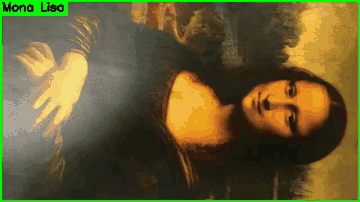
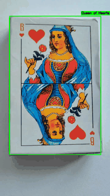

# Трекинг плоского объекта по ключевым точкам

ЛР2: программа получает видео, первый кадр которого — крупное изображение объекта, и на каждом кадре, где объект виден, рисует вокруг него рамку с подписью. Python + OpenCV.

## Запуск

```bash
python -m venv .venv
.venv/bin/pip install -r requirements.txt
.venv/bin/python main.py data/mona-lisa.avi -o results/mona-lisa_sift.mp4 -l "Mona Lisa"
```

Если объект занимает не весь первый кадр, его прямоугольник задаётся через `--roi X Y W H`:

```bash
.venv/bin/python main.py data/my-test.mp4 -o results/my-test_sift.mp4 -l "Queen of Hearts" --roi 62 105 598 905
```

Основные параметры:

| Параметр | Назначение |
| --- | --- |
| `-d sift\|orb\|akaze` | детектор ключевых точек (по умолчанию `sift`) |
| `-l` | подпись рамки |
| `--roi X Y W H` | прямоугольник объекта на первом кадре |
| `--no-flow` | отключить оптический поток |
| `--no-guided` | отключить детекцию в выпрямленном кадре |
| `--min-score` | порог сходства с эталоном (по умолчанию 0.4) |
| `--no-points`, `--no-hud` | не рисовать точки и строку состояния |

Программа печатает JSON со статистикой: доля кадров с найденным объектом, сколько рамок дал каждый источник, среднее число инлаеров, среднее сходство с эталоном, скорость.

Сравнение детекторов и режимов на всех тестовых видео:

```bash
.venv/bin/python benchmark.py
```

Таблица сохраняется в `results/metrics.csv` и `results/metrics.md`.

## Как это работает

Эталон — первый кадр (или его часть, заданная `--roi`). Ключевые точки эталона считаются на трёх масштабах (1, 0.5, 0.25), потому что дальше в видео объект в несколько раз мельче.

На каждом кадре строится до трёх вариантов положения объекта:

1. **Детекция.** Ключевые точки кадра сопоставляются с эталоном (kNN + тест Лоу 0.75), по совпадениям RANSAC находит гомографию.
2. **Детекция в выпрямленном кадре.** Кадр разворачивается по гомографии предыдущего кадра так, чтобы объект выглядел как на эталоне, и сопоставление повторяется. После выпрямления масштаб и ракурс почти совпадают с эталоном, поэтому совпадений в несколько раз больше, чем при обычной детекции на мелком или смазанном объекте.
3. **Оптический поток.** Точки внутри прошлой рамки отслеживаются методом Лукаса — Канаде с проверкой «вперёд-назад», и гомография предыдущего кадра домножается на найденное смещение.

Когда объект мелкий (меньше четверти размера эталона), во втором и третьем вариантах вместо гомографии оценивается аффинное преобразование: перспектива на объекте в 60 пикселей по точкам не определяется, и её оценка только раскачивает рамку.

Каждый вариант проходит проверки:

- геометрия: объект перед камерой, четырёхугольник выпуклый и не зеркальный, площадь от 0.2% до 400% кадра, противоположные стороны отличаются не более чем в 4 раза;
- сходство: кадр выпрямляется найденной гомографией, уменьшается до 80 пикселей по ширине и сравнивается с эталоном нормированной корреляцией. Вариант с оценкой ниже порога отбрасывается — это убирает ложные рамки от случайных совпадений.

Из прошедших проверку выбирается вариант с наибольшим сходством. Детекция имеет приоритет над потоком при разнице до 0.05: она привязана к эталону и не накапливает ошибку, а поток нужен там, где детекция не справляется.

## Структура

| Файл | Содержимое |
| --- | --- |
| `main.py` | разбор аргументов, чтение и запись видео, статистика |
| `benchmark.py` | прогон по видео, детекторам и режимам |
| `tracker/features.py` | детекторы SIFT / ORB / AKAZE и сопоставление |
| `tracker/tracker.py` | трекер: детекция, поток, проверки, выбор варианта |
| `tracker/draw.py` | отрисовка рамки, подписи и точек |
| `data/` | тестовые видео, образец `simple_track.avi` и своё видео `my-test.mp4` |

## Как это выглядит

| `mona-lisa.avi` | `mona-lisa-blur-extra-credit.avi` | `my-test.mp4` |
| --- | --- | --- |
|  |  |  |

Фрагменты уменьшены и прорежены (каждый четвёртый кадр). Полные видео с рамками создаются командой запуска в `results/`.

## Результаты (SIFT, все три источника включены)

| Видео | Кадров | Найдено | Детекция | Выпрямленная | Поток | Среднее сходство |
| --- | --- | --- | --- | --- | --- | --- |
| `mona-lisa.avi` | 558 | 100% | 177 | 254 | 127 | 0.67 |
| `mona-lisa-blur.avi` | 558 | 96.6% | 179 | 235 | 125 | 0.66 |
| `mona-lisa-blur-extra-credit.avi` | 558 | 95.0% | 181 | 203 | 146 | 0.67 |
| `my-test.mp4` (720×1280) | 608 | 100% | 143 | 310 | 155 | 0.91 |

Столбцы «Детекция», «Выпрямленная», «Поток» — число кадров, на которых рамку дал соответствующий источник. В смазанных видео объект теряется на двух участках: в начале (кадры примерно 10–29) и, в `extra-credit`, на кадрах 391–399.

Скорость — около 10 кадров/с на видео 640×360 и около 3 кадров/с на 720×1280 (SIFT, CPU).

Число кадров по источникам немного меняется от запуска к запуску, потому что RANSAC случайный; доля найденных кадров при этом не меняется.

## Сравнение детекторов и режимов

Доля кадров с найденным объектом по трём тестовым видео (`mona-lisa` / `blur` / `extra-credit`):

| Детектор | Только детекция | + выпрямленная | + поток | Сходство (полный режим) | Скорость (полный режим) |
| --- | --- | --- | --- | --- | --- |
| SIFT | 55% / 52% / 47% | 73% / 68% / 65% | 100% / 96.6% / 95.0% | 0.66–0.67 | ~10 кадров/с |
| ORB | 46% / 43% / 39% | 63% / 60% / 58% | 100% / 96.6% / 95.0% | 0.64–0.66 | ~19 кадров/с |
| AKAZE | 41% / 37% / 37% | 66% / 63% / 61% | 100% / 96.6% / 95.0% | 0.63–0.64 | ~31 кадр/с |

- Одна детекция держит объект меньше чем на половине кадров; выпрямленная детекция добавляет 17–26 процентных пунктов, остальное закрывает поток.
- В полном режиме все три детектора теряют одни и те же кадры, то есть потери определяются самими кадрами, а не детектором.
- SIFT даёт наибольшее сходство с эталоном, AKAZE втрое быстрее.

Сходство — косвенная оценка точности: размеченных вручную рамок нет, поэтому ошибка в пикселях не измеряется.

Полная таблица по всем 27 прогонам: [results/metrics.md](results/metrics.md), [results/metrics.csv](results/metrics.csv).
